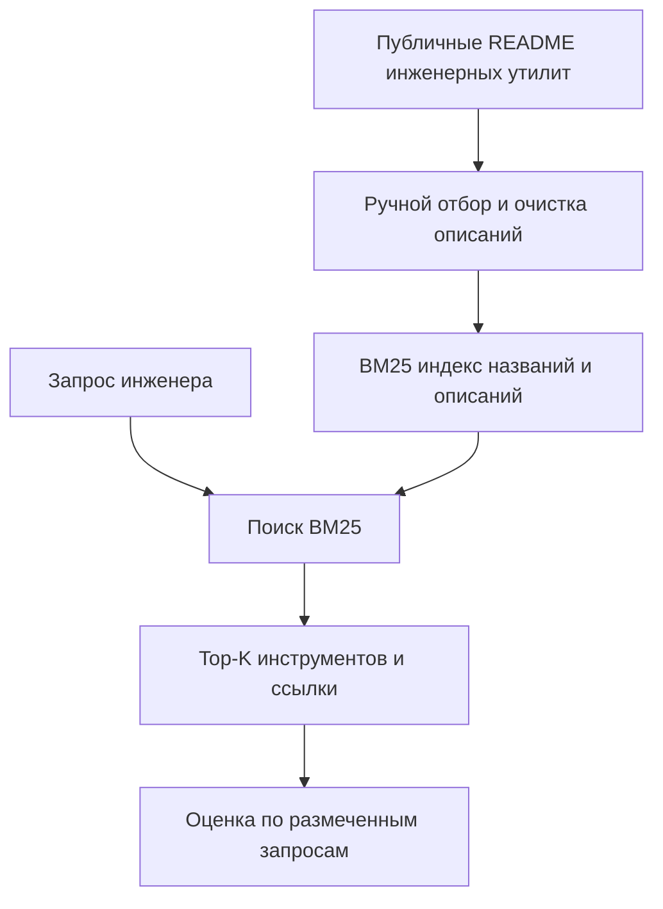
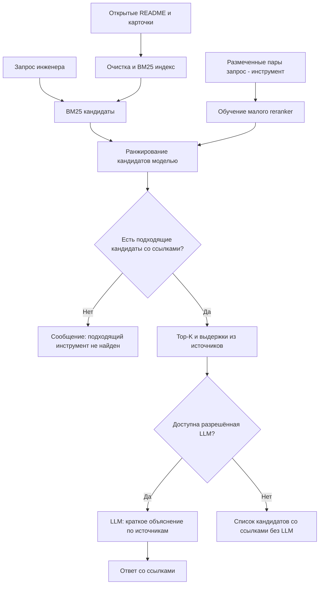

# Дизайн ML-системы - Engineering Tools Discovery Assistant - MVP

**Тема MLSD:** Проектирование интеллектуальной системы поиска и рекомендаций инженерных инструментов на основе RAG.

## 1. Цели и предпосылки

### 1.1. Обоснование необходимости разработки

**Проблема.** Описания инженерных утилит находятся в README и документации разных проектов. Инженер обычно формулирует запрос через свою задачу («чем собрать диагностические логи?»), а документы - через названия утилит. Поиск и сравнение подходящих решений требует значительных временных затрат. Масштаб этой проблемы для конкретной организации пока не измерен.

**Цель.** Разработать по описанию задачи систему поиска подходящей существующей утилиты и дать проверяемые ссылки на её документацию.

**Пользователь:** инженер, выбирающий инструмент. **Действие после ответа:** изучить рекомендованные варианты и перейти к документации, а не автоматически запускать или изменять код.

**Зачем здесь ML:** сначала проверим обычный поиск BM25. Обучаемое ранжирование оправдано только при измеримом улучшении качества на тех же запросах. RAG нужен для краткого объяснения с опорой на найденные материалы; сама генерация не заменяет поиск.

**Критерии успеха итерации:** получен воспроизводимый результат BM25 и обучаемого ранжирования на отложенных запросах; видны реальные ошибки; демонстрационный ответ содержит ссылки на использованные публичные источники. Время поиска и бизнес-выгода - гипотезы, а не обещанные показатели.

### 1.2. Бизнес-требования и ограничения

| ID | Требование | Как проверим |
| --- | --- | --- |
| FR-01 | Принимать текст задачи на естественном языке. | Несколько заранее подготовленных запросов обрабатываются. |
| FR-02 | Находить и ранжировать инструменты по публичным описаниям и README. | Сравнение с ручной разметкой релевантности. |
| FR-03 | Для рекомендации показывать название, краткое обоснование и ссылку на источник. | Ссылка существует; утверждение подтверждается документом. |
| FR-04 | Не придумывать инструмент при отсутствии подтверждений. | Запрос без подходящего инструмента обрабатывается корректно. |
| FR-05 | Для демонстрации RAG формировать короткий ответ по найденным материалам, если доступен разрешённый LLM-инференс. | Ручная проверка нескольких ответов и ссылок. |

| Ограничение | Решение для MVP |
| --- | --- |
| Конфиденциальность | Только публичные или разрешённые к использованию материалы; закрытые данные и секреты не используются. |
| Объём работы | Небольшой корпус, ручная подготовка карточек; без автоматической обработки репозиториев LLM. |
| Воспроизводимость | Версионируемые скрипты, фиксированная схема разбиения данных и `uv.lock`. |
| Качество | Сравнение с BM25 и честный анализ ошибок; не обещаем заранее выигрыш ML. |
| Ресурсы | Не обучаем большую LLM; небольшая модель ранжирования обучается локально. |

**План проверки полезности:** на одинаковом наборе типовых запросов сравнить ранжирование BM25 и ML; отдельно вручную оценить понятность рекомендаций и наличие подтверждающих источников.

### 1.3. Область проекта

**Входы:** запрос инженера; публичные README/описания инженерных утилит; ссылки на источники; для эксперимента - вручную размеченные пары «запрос - инструмент».

**Выходы:** список подходящих инструментов, краткое объяснение и ссылки; если подходящих вариантов нет - сообщение о недостатке информации. При наличии доступа к разрешённой LLM - краткий RAG-ответ на основе найденных фрагментов.

**Границы MVP:**

1. Собрать ориентировочно 10-20 публичных описаний инструментов и 40-60 типовых запросов. Объёмы предварительные и уточняются после EDA.
2. Провести EDA, проверить качество и получить простую ручную разметку релевантности.
3. Реализовать BM25 и обучить небольшой reranker; сравнить их по одинаковым метрикам.
4. Собрать минимальную цепочку RAG на найденных источниках, если доступен допустимый LLM API/локальная модель; проверить корректность примеров вручную.
5. Описать архитектуру и ограничения системы. При необходимости провести базовое тестирование производительности минимального локального API.

**Качество результата:** воспроизводимый код экспериментов, описание источников данных, зафиксированные зависимости и отчёт с фактически полученными метриками.

### 1.4. Предпосылки решения

- Существуют публичные README с достаточно понятными описаниями назначения инструментов и допустимыми условиями использования.
- Можно вручную составить и проверить небольшие наборы запросов и меток релевантности.
- Для обучения хватит ресурсов обычного компьютера; модель ранжирования будет небольшой.
- Доступ к LLM для генерации пока не гарантирован. Если его не будет, поиск и обучаемую модель можно оценить независимо, а RAG останется нереализованным до выбора разрешённого способа инференса.

**Основные риски:** малый и неоднородный корпус -> недостаточное качество модели; неточная разметка -> недостоверная оценка; галлюцинации LLM -> ошибочные объяснения. Реакция: анализ данных и ручная проверка меток, сравнение с простым бейзлайном, обязательные ссылки и отказ при нехватке подтверждений.

## 2. Методология

### 2.1. Постановка задачи

**ML-задача:** ранжирование инженерных инструментов по релевантности текстовому запросу (`learning-to-rank`). Единица разметки - пара «запрос - инструмент», целевая метка - степень релевантности: 0 (не подходит), 1 (подходит частично), 2 (подходит напрямую). Для обучения ранжировщика пары группируются по запросу.

**Бейзлайн:** BM25 по названию и описанию инструмента. BM25 не обучается как supervised-модель.

**Основная модель:** основной кандидат - LightGBM Ranker (LambdaMART), ранжирующий инструменты по BM25-score и признакам текстового сходства. Обучающие примеры группируются по запросам. Окончательный выбор модели и признаков уточним после EDA.

**Оценка:** разбить запросы на train/validation/test, не допускать утечки похожих перефразировок между частями. Сравнить BM25 и обучаемую модель на одном тесте по Recall@3 и nDCG@5 (при необходимости MRR). Результат может оказаться хуже бейзлайна - это допустимый и содержательный вывод.

**RAG - отдельный слой:** взять найденные фрагменты и запросить у готовой разрешённой LLM короткий ответ со ссылками. Вызов API - это инференс, а не обучение модели. Ранжирование оценивается отдельно от качества генерации.

### 2.2. Блок-схема решения

**Бейзлайн: BM25 по открытым описаниям инженерных инструментов.**

**MVP: обучаемое ранжирование и простой RAG.**

**Пояснение:** схема отражает поиск инженерных инструментов. В MVP нет авторизации пользователей, автоматической синхронизации источников и обновления каталога. Если обучаемая модель не улучшает результаты, допустимо оставить BM25 как основной метод.

### 2.3. Этапы решения задачи

#### Этап 1. Подготовка данных

**Единицы данных:** инструмент (`tool_id`, название, категория, два кратких описания,
`source_url`), запрос инженера (`query_id`, текст, семейство сценария), пара
«запрос - инструмент» (степень релевантности 0/1/2). Все поля доступны в
`data/`; происхождение и ограничение достоверности разметки - `data/README.md`.

**Источники и процесс:** в открытый корпус включены 18 реальных инструментов из 6 категорий.
Назначение каждого сверено с публичной документацией; в карточке сохранена ссылка
на источник. Описания на русском и английском составлены на основе возможностей
инструментов; полные README не копируются. Для проекта подготовлено 17 типовых
инженерных сценариев по три естественные формулировки (51 запрос). Эти вопросы
отражают задачи, с которыми инженер может обратиться к поисковому ассистенту;
они не выдаются за собранную историю пользовательских обращений.
Релевантность 0/1/2 назначена по матрице соответствия возможностей инструментов
запросам; `scripts/build_dataset.py` разворачивает её в 918 пар, сохраняет
групповое разбиение и воспроизводимую структуру данных.

**Закрытая часть:** дополнительно подготовлены карточки и разметка для 5 инструментов
с ограниченным доступом. Их данные не входят в публичный репозиторий и EDA.
Использование при обучении предполагается отдельно, в разрешённом закрытом контуре;
публичные эксперименты и их метрики должны оставаться воспроизводимыми без них.

**Результаты EDA:** `notebooks/01_eda.ipynb`, `reports/eda_findings.md` и шесть
графиков в `reports/figures/`. В составе: 18 карточек (debugging - 4,
http - 3, monitoring - 3, network - 3, performance - 2, storage - 3);
51 запрос (train - 33, validation - 9, test - 9); 918 пар: 846 с меткой 0,
24 с меткой 1 и 48 с меткой 2. Пропусков обязательных полей, повторных ID,
дублирующихся запросов и повторных пар не найдено. Медиана длины русской карточки
- 16 слов, запроса - 8 слов. Три test-запроса относятся к теме вне каталога
(редактирование PDF), для них нет положительных меток.

**Проблемы и риски:** открытый корпус небольшой, описания короткие, категории
неравномерно представлены в разбиениях. Три перефразировки одного намерения
не являются тремя независимыми задачами, поэтому разделены по `family_id`.
Нулевые метки отражают отсутствие соответствия в составленной матрице, а не
экспертный просмотр каждой отрицательной пары; для финальной оценки нужно
перепроверить тестовые пары и спорные соответствия. Возможен языковой разрыв
между русскими запросами и английской документацией. Публичный датасет не
содержит данных закрытой части, поэтому её эффект оценивается отдельно.

**Как улучшим:** перед итоговой оценкой проверить все 162 пары test и спорные
соответствия train/validation. По мере развития системы добавить 20-30
независимых сценариев, по возможности собранных у инженеров, и фрагменты README
с фиксацией версии источника. Для небольшого специализированного каталога
компактный корпус обоснован; его достаточность оценивается качеством поиска,
а не абсолютным числом записей.

**Конфиденциальность:** публикуем только карточки открытых инструментов и
составленные для проекта тексты запросов. В открытом датасете нет персональных
сведений и закрытой документации. Пять инструментов с ограниченным доступом
остаются вне репозитория; их применение возможно только при наличии разрешения,
без публикации исходных текстов, идентификаторов или производных артефактов.

**Выход этапа:** воспроизводимые `tools.csv`, `queries.csv`, `relevance_labels.csv`,
EDA с графиками и список недостатков/проверок перед достоверной оценкой модели.

#### Этап 2. Подготовка прогнозных моделей

**Цель:** упорядочить доступные инструменты по релевантности запросу. Сначала
сравним простые алгоритмы с более сложными, не предполагая улучшения заранее.

**Бейзлайн:** BM25 по названию, `description_ru` и, отдельно в абляции, двуязычному
описанию; приведение регистра и единая токенизация запроса и документа.
Никакого обучения по меткам для BM25 не нужно. В эксперименте фиксируем корпус,
параметры BM25 и `Top-K`; возможный дополнительный baseline - простой TF-IDF.

**Основной кандидат:** LightGBM Ranker / LambdaMART при достаточности данных;
каждая строка обучения - пара «запрос - инструмент», группы состоят из документов
одного `query_id`. Возможные признаки: BM25 score, перекрытие токенов,
совпадение названия инструмента, косинусное сходство TF-IDF и длина текста.
Учитывая малый корпус, сначала проверим простую модель и не станем подгонять
сложные эмбеддинги или LLM. Целевая функция LambdaMART ориентирована на
качество порядка (например, NDCG); при переходе к бинарной классификации
потребуется отдельное обоснование функции потерь.

**ML-метрики:** Recall@3 по положительным меткам (покрытие полезных инструментов
в первых трёх), nDCG@5 по степеням 0/1/2 (учёт позиции и частичной релевантности),
дополнительно MRR для первой подходящей рекомендации. В исходной выборке
отдельно считаем число запросов с ответом и без ответа. Для запросов без
релевантных инструментов Recall/nDCG не определяем как «хорошее ранжирование»:
вместо этого измеряем корректность отказа и частоту ложных рекомендаций.
Качество на текущем корпусе оцениваем после проверки тестовых соответствий;
результаты не экстраполируем на весь спектр пользовательских задач.

**Валидация:** фиксированные train/validation/test из `queries.csv` (33/9/9).
Все три перефразировки одного `family_id` принадлежат одной части, поэтому
почти одинаковые запросы не попадают одновременно в обучение и тест. Поскольку
test содержит только два сценария с ответом и один без ответа, оценки шумные;
по возможности повторим анализ по новым семействам. Настройка гиперпараметров
и порога отказа только на train/validation; тест не используем для выбора
признаков, модели и отсечения. Перед итоговым сравнением нужно проверить соответствия test.

**Интерпретация и ошибки:** смотреть Recall@3 и nDCG@5 по семействам и категориям,
разбирать запросы, где BM25 не находит нужную карточку или модель повышает в
рейтинге неподходящий инструмент. Проверять устойчивость к сокращениям,
парафразам и смешению русского и английского языков. Для LightGBM сравнить
важность признаков и ошибочные Top-K. Изменение набора кандидатов отделить
от эффекта reranking.

**Риски:** переобучение на 11 обучающих семействах, непроверенные нули в разметке,
смещение к названиям утилит, утечка между парафразами, потеря релевантного
инструмента при поиске кандидатов. Снижение риска: ручная верификация,
family-wise split, фиксированный тест, сравнение с BM25 и анализ ошибок.
Если ML не выигрывает честно, оставляем BM25.

**Выход этапа:** воспроизводимый бейзлайн на открытых данных, схема групповой валидации, согласованные
метрики и план ограниченного обучения/сравнения для ДЗ №3. В ДЗ №2 метрики
обученной модели не заявляются: обучение ещё не проводилось.

#### Этап 3. Поиск и ранжирование кандидатов (специфика retrieval)

Построить индекс карточек, получить по запросу кандидатов BM25, опционально
переранжировать их LightGBM и вернуть до Top-3 инструментов со ссылками на
источники. Для корпуса в 18 инструментов при отладке можно ранжировать весь
каталог; после расширения проверить Recall кандидатов при Top-10. Если
релевантная карточка отсечена на раннем этапе, reranker её уже не восстановит.
Зафиксировать версию данных и индекс, анализировать случаи отсутствия нужного
кандидата. Результат - список кандидатов и проверяемые ссылки.

#### Этап 4. Ответ и проверка источников (специфика RAG)

На основе найденных карточек собрать короткое объяснение, указать `source_url`
для каждого рекомендованного инструмента. Если разрешённый LLM-инференс недоступен,
возвращать список инструментов без генерации. Не считать ссылку доказательством
любого произвольного утверждения: вручную проверять поддержку вывода текстом
источника. Для запросов без релевантных кандидатов нужен отказ, а не
галлюцинированная рекомендация. Отдельная ручная оценка: корректность ссылок,
подтверждаемость, отсутствие выдуманных функций. Результат - безопасный формат
демонстрационного ответа и критерии его проверки.

## 3. Подготовка пилота

Предварительная идея: воспроизводимая проверка на заранее размеченных типовых задачах с сопоставлением BM25 и обучаемого ранжирования. Описать сценарии, метрики, ограничения и критерии перехода к следующей итерации.

## 4. Внедрение

Схема компонентов, характеристики минимального сервиса и подход к нагрузочному тестированию будет уточнён после первых экспериментов.
