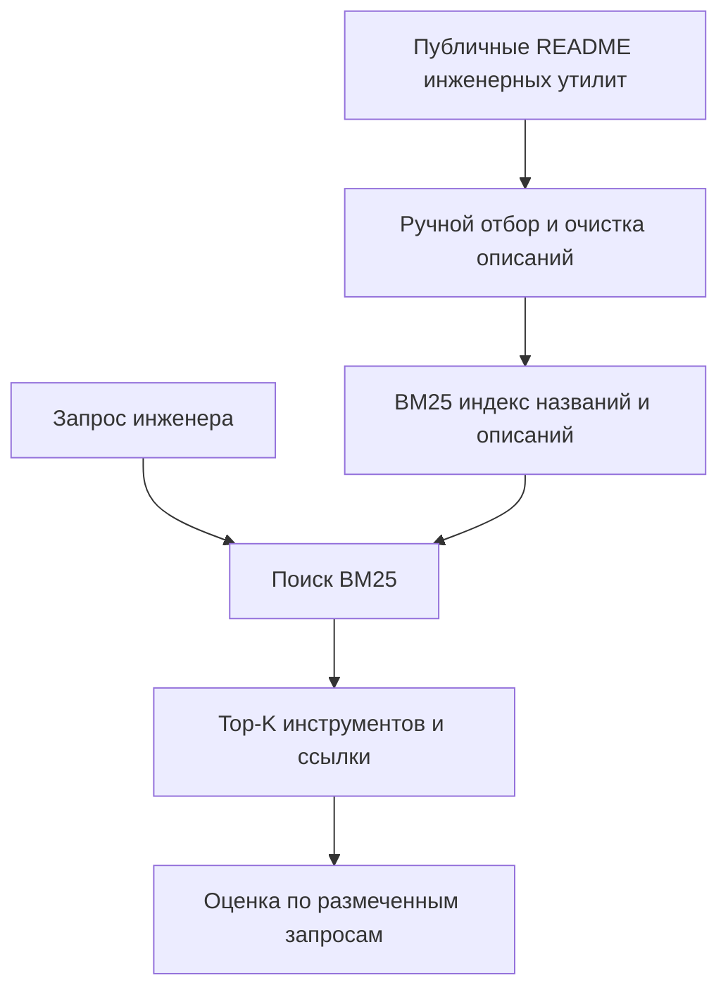
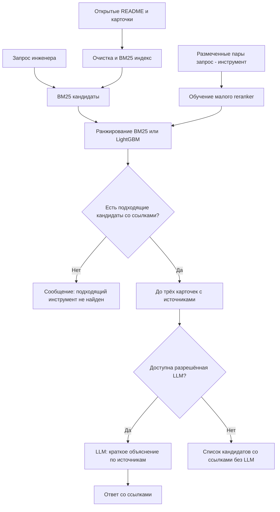

# Дизайн ML-системы - Engineering Tools Discovery Assistant - MVP

**Тема MLSD:** Проектирование интеллектуальной системы поиска и рекомендаций инженерных инструментов на основе RAG.

## 1. Цели и предпосылки

### 1.1. Зачем идём в разработку продукта?

**Проблема.** Описания инженерных утилит находятся в README и документации разных проектов. Инженер обычно формулирует запрос через свою задачу («чем собрать диагностические логи?»), а документы - через названия утилит. Поиск и сравнение подходящих решений требует значительных временных затрат. Масштаб этой проблемы для конкретной организации пока не измерен.

**Цель.** Разработать по описанию задачи систему поиска подходящей существующей утилиты и дать проверяемые ссылки на её документацию.

Инженер спрашивает «Как измерить TCP throughput между двумя машинами?» -> получает карточку iperf3
с объяснением, что утилита измеряет пропускную способность сети -> открывает документацию для
выбора инструмента. [Документация iperf3](https://github.com/esnet/iperf)

**Зачем здесь ML:** сначала проверим обычный поиск BM25. Обучаемое ранжирование оправдано только при измеримом улучшении качества на тех же запросах. RAG нужен для краткого объяснения с опорой на найденные материалы; сама генерация не заменяет поиск.

**Критерии успеха итерации:** получен воспроизводимый результат BM25 и обучаемого ранжирования на отложенных запросах; видны реальные ошибки; демонстрационный ответ содержит ссылки на использованные публичные источники. Время поиска и бизнес-выгода - гипотезы, а не обещанные показатели.

### 1.2. Бизнес-требования и ограничения

| ID | Требование | Как проверим |
| --- | --- | --- |
| FR-01 | Принимать текст задачи на естественном языке. | Несколько заранее подготовленных запросов обрабатываются. |
| FR-02 | Находить и ранжировать инструменты по публичным описаниям и README. | Сравнение с ручной разметкой релевантности. |
| FR-03 | Для рекомендации показывать название, краткое обоснование и ссылку на источник. | Ссылка существует; утверждение подтверждается документом. |
| FR-04 | Не придумывать инструмент при отсутствии подтверждений. | Запрос без подходящего инструмента обрабатывается корректно. |
| FR-05 | Для демонстрации RAG формировать короткий ответ по найденным материалам, если доступен разрешённый LLM-инференс. | Ручная проверка нескольких ответов и ссылок. |

| Ограничение | Решение для MVP |
| --- | --- |
| Конфиденциальность | Только публичные или разрешённые к использованию материалы; закрытые данные и секреты не используются. |
| Объём работы | Небольшой корпус, ручная подготовка карточек; без автоматической обработки репозиториев LLM. |
| Воспроизводимость | Версионируемые скрипты, фиксированная схема разбиения данных и `uv.lock`. |
| Качество | Сравнение с BM25 и честный анализ ошибок; не обещаем заранее выигрыш ML. |
| Ресурсы | Не обучаем большую LLM; небольшая модель ранжирования обучается локально. |

В пилоте инженеры выбирают утилиты с помощью ассистента и вручную по тем же публичным источникам.
Пилот успешен, если медианное время до подтверждённого выбора сокращается минимум на 20%, а доля
задач, решённых за 5 минут, сохраняется или растёт. [Протокол пилота](#3-подготовка-пилота)

### 1.3. Область проекта

**Входы:** запрос инженера; публичные README/описания инженерных утилит; ссылки на источники; для эксперимента - вручную размеченные пары «запрос - инструмент».

На один запрос сервис возвращает до трёх инструментов с названием, кратким обоснованием и
`source_url` для каждого. При отсутствии подходящего инструмента сервис сообщает об этом.
Если доступна разрешённая LLM, она формирует краткое обоснование по найденным карточкам.

**Границы MVP:**

1. Собрать ориентировочно 10-20 публичных описаний инструментов и 40-60 типовых запросов. Объёмы предварительные и уточняются после EDA.
2. Провести EDA, проверить качество и получить простую ручную разметку релевантности.
3. Реализовать BM25 и обучить небольшой reranker; сравнить их по одинаковым метрикам.
4. Собрать минимальную цепочку RAG на найденных источниках, если доступен допустимый LLM API/локальная модель; проверить корректность примеров вручную.
5. Описать архитектуру и ограничения системы. При необходимости провести базовое тестирование производительности минимального локального API.

За рамками MVP остаются многоходовый диалог, подсказки при вводе запроса, сохранение истории
запросов и диалогов в БД, запуск команд, установка ПО, авторизация и автоматическое обновление
каталога.

**Качество результата:** воспроизводимый код экспериментов, описание источников данных, зафиксированные зависимости и отчёт с фактически полученными метриками.

### 1.4. Предпосылки решения

Для первого каталога берём утилиты для работы с дисками, сетью, отладкой и мониторингом.
Карточку составляем по публичной документации. В ней фиксируем название, категорию, краткое
описание возможностей и `source_url`. Релевантность размечаем вручную по каждому сценарию.

| Пример запроса | Ожидаемый результат |
| --- | --- |
| Надо проверить износ и температуру накопителя | smartmontools (2) показывает показатели SMART. nvme-cli (1) подходит для проверки накопителей NVMe. [smartmontools](https://github.com/smartmontools/smartmontools), [nvme-cli](https://github.com/linux-nvme/nvme-cli) |
| Нужно изменить текст внутри PDF без конвертации | Явный отказ. Задача вне тематики каталога. |

Перед каждым пилотом сверяем карточки и ссылки с официальной документацией и фиксируем дату
проверки. Для всех прогонов используем один коммит каталога.

- Для обучения хватит ресурсов обычного компьютера; модель ранжирования будет небольшой.
- Доступ к LLM для генерации пока не гарантирован. Если его не будет, поиск и обучаемую модель можно оценить независимо, а RAG останется нереализованным до выбора разрешённого способа инференса.

**Основные риски:** малый и неоднородный корпус -> недостаточное качество модели; неточная разметка -> недостоверная оценка; галлюцинации LLM -> ошибочные объяснения. Реакция: анализ данных и ручная проверка меток, сравнение с простым бейзлайном, обязательные ссылки и отказ при нехватке подтверждений.

## 2. Методология

### 2.1. Постановка задачи

**ML-задача:** ранжирование инженерных инструментов по релевантности текстовому запросу (`learning-to-rank`). Единица разметки - пара «запрос - инструмент», целевая метка - степень релевантности: 0 (не подходит), 1 (подходит частично), 2 (подходит напрямую). Для обучения ранжировщика пары группируются по запросу.

**Бейзлайн:** BM25 по названию и описанию инструмента. BM25 не обучается как supervised-модель.

Кандидат для переранжирования - LightGBM Ranker (LambdaMART). Он использует оценку BM25 и признаки
текстового сходства. Группа для обучения задаётся по `query_id`.

Запросы разделим на train/validation/test по `family_id`, чтобы перефразировки одной задачи
оставались в одной части. На запросах с ответом усредняем Recall@3 (доля всех инструментов с
меткой 1 или 2 в первой тройке) и nDCG@5 (DCG первых пяти позиций относительно идеального порядка
по меткам 0/1/2). Считаем их до ограничения выдачи тремя карточками. На запросах без ответа
проверяем долю корректных отказов.

**RAG - отдельный слой:** взять найденные фрагменты и запросить у готовой разрешённой LLM короткий ответ со ссылками. Вызов API - это инференс, а не обучение модели. Ранжирование оценивается отдельно от качества генерации.

### 2.2. Блок-схема решения

**Бейзлайн: BM25 по открытым описаниям инженерных инструментов.**

**MVP с опциональным переранжированием и RAG**

### 2.3. Этапы решения задачи

Заполняем после EDA.

## 3. Подготовка пилота

До пилота сравним BM25 и LightGBM на одном каталоге и отложенных размеченных запросах. Базовый
вариант для пилота - BM25. LightGBM используем, если его nDCG@5 выше при Recall@3 не ниже BM25.
Гиперпараметры и порог отказа подбираем на валидации, в которую войдут запросы с подходящим
инструментом и без него.

Для пилота берём 20 новых задач от инженеров (15 с подходящим инструментом и 5 без него) и
заранее фиксируем эталонные ответы и режим генерации. Каждую задачу один инженер решает вручную,
другой - с ассистентом. Участники пробуют оба режима на разных задачах. Для каждой попытки
фиксируем время и выбор инструмента со ссылкой либо отказ.

| Критерий | Как измеряем | Порог успеха |
| --- | --- | --- |
| Время выбора | На задачах с ответом считаем медиану времени от получения задачи до выбора подходящего инструмента с подтверждающей ссылкой. Если выбора нет или он ошибочный, засчитываем лимит 5 минут. | Минимум на 20% меньше, чем при ручном поиске. |
| Доля решённых задач | Доля задач с подходящим инструментом, где выбор подтверждён за 5 минут. | Не ниже ручного поиска. |
| Корректный отказ | На задачах без подходящего инструмента считаем ответы без рекомендаций с явным отказом. | Не менее 4 из 5. |
| Обоснованность | Вручную проверяем ссылку и подтверждение объяснения в источнике для каждой рекомендации. | Все рекомендации подтверждены. |

Пороги задаём до замеров. При их выполнении переходим к расширению каталога. По критериям,
которые не выполнились, разбираем ошибки и повторяем проверку на новых задачах.

## 4. Внедрение

Схему компонентов, характеристики минимального сервиса и подход к нагрузочному тестированию уточним после первых экспериментов.
