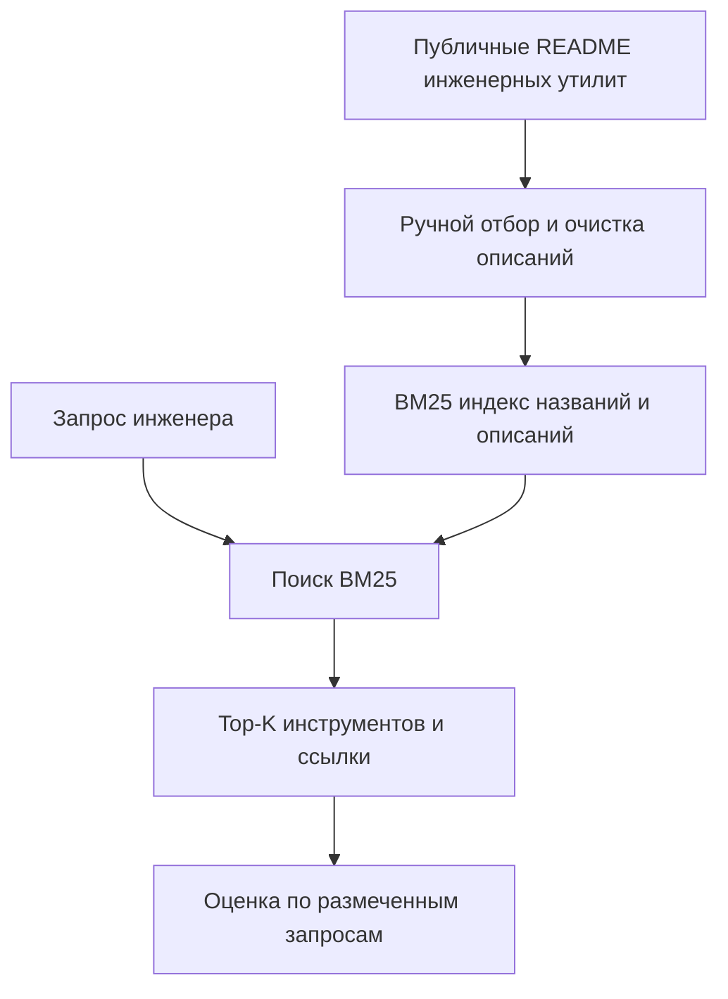
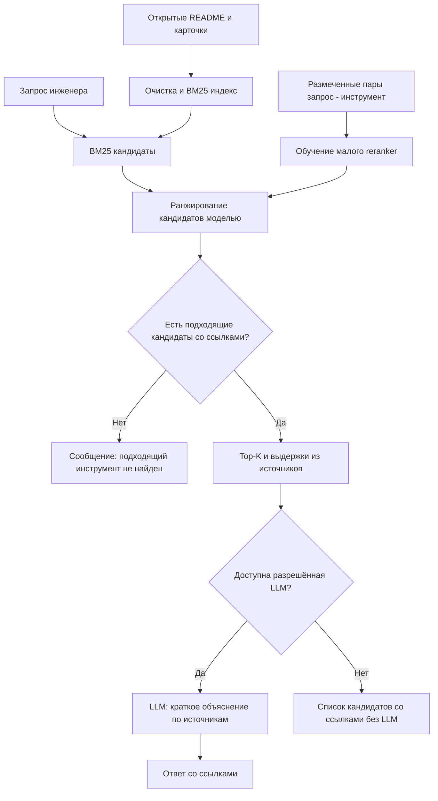

# Дизайн ML-системы - Engineering Tools Discovery Assistant - MVP

**Тема MLSD:** Проектирование интеллектуальной системы поиска и рекомендаций инженерных инструментов на основе RAG.

## 1. Цели и предпосылки

### 1.1. Зачем идём в разработку продукта?

**Проблема.** Описания инженерных утилит находятся в README и документации разных проектов. Инженер обычно формулирует запрос через свою задачу («чем собрать диагностические логи?»), а документы - через названия утилит. Поиск и сравнение подходящих решений требует значительных временных затрат. Масштаб этой проблемы для конкретной организации пока не измерен.

**Цель.** Разработать по описанию задачи систему поиска подходящей существующей утилиты и дать проверяемые ссылки на её документацию.

**Пользователь:** инженер, выбирающий инструмент. **Действие после ответа:** изучить рекомендованные варианты и перейти к документации, а не автоматически запускать или изменять код.

**Зачем здесь ML:** сначала проверим обычный поиск BM25. Обучаемое ранжирование оправдано только при измеримом улучшении качества на тех же запросах. RAG нужен для краткого объяснения с опорой на найденные материалы; сама генерация не заменяет поиск.

**Критерии успеха итерации:** получен воспроизводимый результат BM25 и обучаемого ранжирования на отложенных запросах; видны реальные ошибки; демонстрационный ответ содержит ссылки на использованные публичные источники. Время поиска и бизнес-выгода - гипотезы, а не обещанные показатели.

### 1.2. Бизнес-требования и ограничения

| ID | Требование | Как проверим |
| --- | --- | --- |
| FR-01 | Принимать текст задачи на естественном языке. | Несколько заранее подготовленных запросов обрабатываются. |
| FR-02 | Находить и ранжировать инструменты по публичным описаниям и README. | Сравнение с ручной разметкой релевантности. |
| FR-03 | Для рекомендации показывать название, краткое обоснование и ссылку на источник. | Ссылка существует; утверждение подтверждается документом. |
| FR-04 | Не придумывать инструмент при отсутствии подтверждений. | Запрос без подходящего инструмента обрабатывается корректно. |
| FR-05 | Для демонстрации RAG формировать короткий ответ по найденным материалам, если доступен разрешённый LLM-инференс. | Ручная проверка нескольких ответов и ссылок. |

| Ограничение | Решение для MVP |
| --- | --- |
| Конфиденциальность | Только публичные или разрешённые к использованию материалы; закрытые данные и секреты не используются. |
| Объём работы | Небольшой корпус, ручная подготовка карточек; без автоматической обработки репозиториев LLM. |
| Воспроизводимость | Версионируемые скрипты, фиксированная схема разбиения данных и `uv.lock`. |
| Качество | Сравнение с BM25 и честный анализ ошибок; не обещаем заранее выигрыш ML. |
| Ресурсы | Не обучаем большую LLM; небольшая модель ранжирования обучается локально. |

**План проверки полезности:** на одинаковом наборе типовых запросов сравнить ранжирование BM25 и ML; отдельно вручную оценить понятность рекомендаций и наличие подтверждающих источников.

### 1.3. Область проекта

**Входы:** запрос инженера; публичные README/описания инженерных утилит; ссылки на источники; для эксперимента - вручную размеченные пары «запрос - инструмент».

**Выходы:** список подходящих инструментов, краткое объяснение и ссылки; если подходящих вариантов нет - сообщение о недостатке информации. При наличии доступа к разрешённой LLM - краткий RAG-ответ на основе найденных фрагментов.

**Границы MVP:**

1. Собрать ориентировочно 10-20 публичных описаний инструментов и 40-60 типовых запросов. Объёмы предварительные и уточняются после EDA.
2. Провести EDA, проверить качество и получить простую ручную разметку релевантности.
3. Реализовать BM25 и обучить небольшой reranker; сравнить их по одинаковым метрикам.
4. Собрать минимальную цепочку RAG на найденных источниках, если доступен допустимый LLM API/локальная модель; проверить корректность примеров вручную.
5. Описать архитектуру и ограничения системы. При необходимости провести базовое тестирование производительности минимального локального API.

**Качество результата:** воспроизводимый код экспериментов, описание источников данных, зафиксированные зависимости и отчёт с фактически полученными метриками.

### 1.4. Предпосылки решения

- Существуют публичные README с достаточно понятными описаниями назначения инструментов и допустимыми условиями использования.
- Можно вручную составить и проверить небольшие наборы запросов и меток релевантности.
- Для обучения хватит ресурсов обычного компьютера; модель ранжирования будет небольшой.
- Доступ к LLM для генерации пока не гарантирован. Если его не будет, поиск и обучаемую модель можно оценить независимо, а RAG останется нереализованным до выбора разрешённого способа инференса.

**Основные риски:** малый и неоднородный корпус -> недостаточное качество модели; неточная разметка -> недостоверная оценка; галлюцинации LLM -> ошибочные объяснения. Реакция: анализ данных и ручная проверка меток, сравнение с простым бейзлайном, обязательные ссылки и отказ при нехватке подтверждений.

## 2. Методология

### 2.1. Постановка задачи

**ML-задача:** ранжирование инженерных инструментов по релевантности текстовому запросу (`learning-to-rank`). Единица разметки - пара «запрос - инструмент», целевая метка - подходит / не подходит. Для обучения ранжировщика пары группируются по запросу. При необходимости после EDA используем градации релевантности.

**Бейзлайн:** BM25 по названию и описанию инструмента. BM25 не обучается как supervised-модель.

**Основная модель:** основной кандидат - LightGBM Ranker (LambdaMART), ранжирующий инструменты по BM25-score и признакам текстового сходства. Обучающие примеры группируются по запросам. Окончательный выбор модели и признаков уточним после EDA.

**Оценка:** разбить запросы на train/validation/test, не допускать утечки похожих перефразировок между частями. Сравнить BM25 и обучаемую модель на одном тесте по Recall@3 и nDCG@5 (при необходимости MRR). Результат может оказаться хуже бейзлайна - это допустимый и содержательный вывод.

**RAG - отдельный слой:** взять найденные фрагменты и запросить у готовой разрешённой LLM короткий ответ со ссылками. Вызов API - это инференс, а не обучение модели. Ранжирование оценивается отдельно от качества генерации.

### 2.2. Блок-схема решения

**Бейзлайн: BM25 по открытым описаниям инженерных инструментов.**

**MVP: обучаемое ранжирование и простой RAG.**

**Пояснение:** схема отражает поиск инженерных инструментов. В MVP нет авторизации пользователей, автоматической синхронизации источников и обновления каталога. Если обучаемая модель не улучшает результаты, допустимо оставить BM25 как основной метод.

### 2.3. Этапы решения задачи

Заполняем после EDA.

## 3. Подготовка пилота

Предварительная идея: воспроизводимая проверка на заранее размеченных типовых задачах с сопоставлением BM25 и обучаемого ранжирования. Описать сценарии, метрики, ограничения и критерии перехода к следующей итерации.

## 4. Внедрение

Схему компонентов, характеристики минимального сервиса и подход к нагрузочному тестированию уточним после первых экспериментов.
