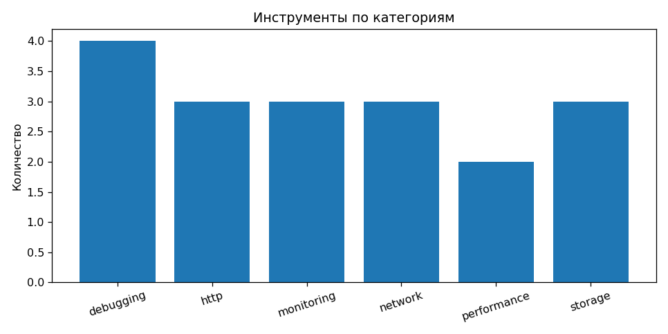
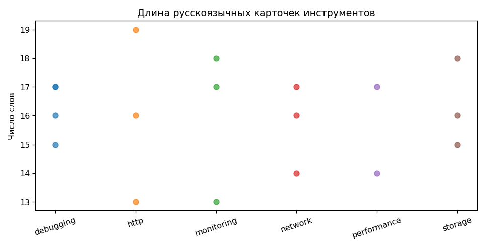
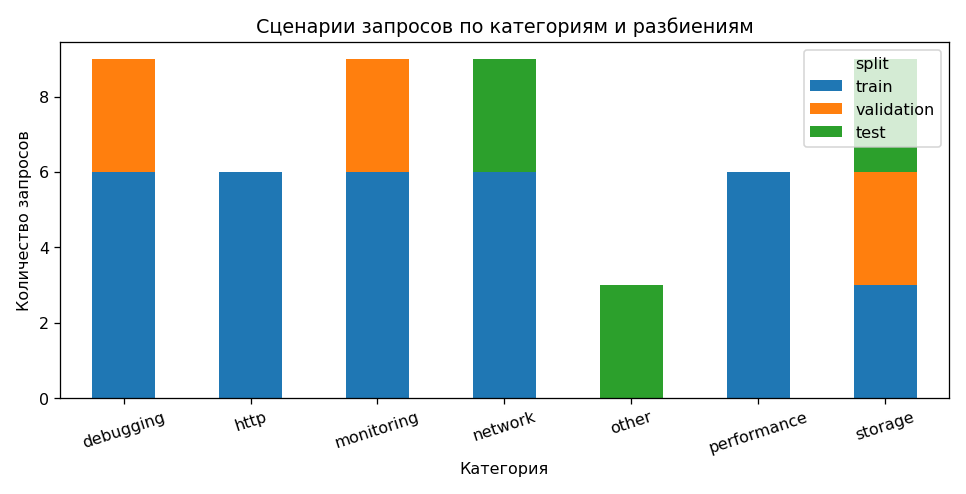
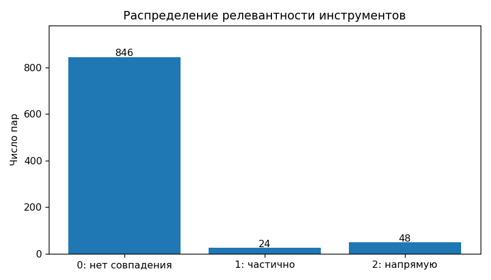
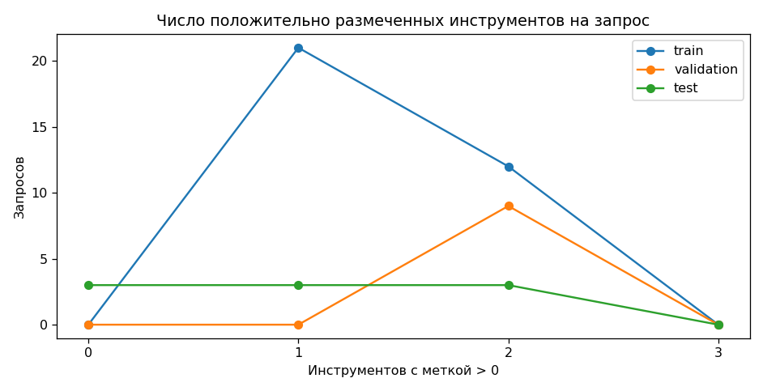
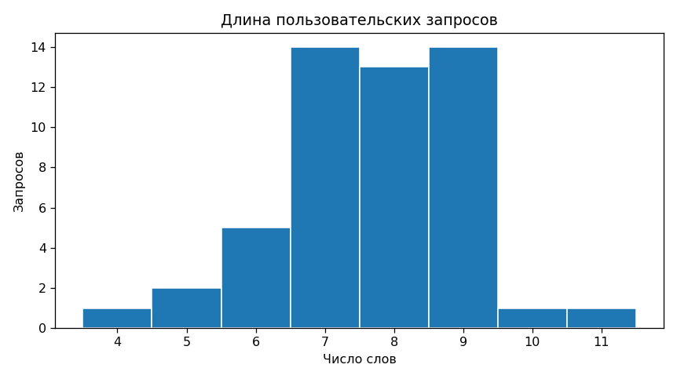

# Результаты EDA - ДЗ №2

Данные: `data/raw/tools.csv`, `data/raw/query_scenarios.csv`,
`data/processed/queries.csv`, `data/processed/relevance_labels.csv`.
Методика и код: `notebooks/01_eda.ipynb`, `scripts/eda.py`.

## Объём и структура

- **18** реальных инструментов из **6** категорий;
  распределение: debugging: 4, http: 3, monitoring: 3, network: 3, performance: 2, storage: 3.
- **51** запросов по инженерным сценариям из **17** семейств
  (по 3 перефразировки): train **33**,
  validation **9**, test **9**.
- **918** пар "запрос - инструмент" (полное декартово произведение).
  Метки релевантности: 0 - **846**, 1 - **24**, 2 - **48**.
  Среднее число положительных меток на запрос: **1.41**.
- **3** запроса из одного семейства заведомо вне каталога: проверка отказа
  при отсутствии подходящего инструмента. В метриках ранжирования отделять от answerable.

## Качество

- Пропусков в критичных полях, повторяющихся ID, повторов запросов и дублированных
  пар не обнаружено. Все записи имеют HTTPS-ссылку на публичный источник
  (это проверка формата URL, не гарантия постоянной доступности ссылок).
- Медианная длина русскоязычной карточки: **16** слов;
  медианная длина запроса: **8** слов.
  Описания краткие и пересказанные, **полные README здесь не загружены**.
- **Особенность разметки:** запросы составлены по типовым инженерным ситуациям;
  соответствия определены по возможностям инструментов. Нули назначаются
  автоматически там, где соответствие не указано. Для окончательной оценки
  необходимо отдельно проверить тестовые пары и неоднозначные случаи.
- Есть лексическая и тематическая близость между тремя запросами одного семейства;
  их нельзя разбивать по разным частям train/validation/test.
- Распределения категорий между частями не одинаковы: на маленьком корпусе
  уверенность в метриках будет низкой. Каталог не отражает всю область инженерных задач.

## Визуализации и выводы

**Вывод:** 6 категорий, но выборка мала; качество по узким категориям ненадёжно.

**Вывод:** короткие карточки ограничивают полноту поиска. При расширении собирать
релевантные фрагменты README, не смешивая обновлённые описания с замороженным тестом.

**Вывод:** валидация и тест отличаются по категориям от train. Метрики интерпретировать
как оценку на зафиксированных сценариях, не как качество на всём потоке обращений.

**Вывод:** нулевые метки преобладают вследствие способа построения полного набора пар.
Перед финальной оценкой проверить все пары теста.

**Вывод:** некоторым задачам соответствует несколько утилит, а для запросов вне
каталога нет положительных. Для поиска нужны Recall@3 / nDCG@5; для отказа - отдельная проверка.

**Вывод:** запросы короткие, на русском языке, часто содержат английские термины.
Следует сравнить BM25 на русском описании и двуязычном поле, а затем обучаемый reranker.
